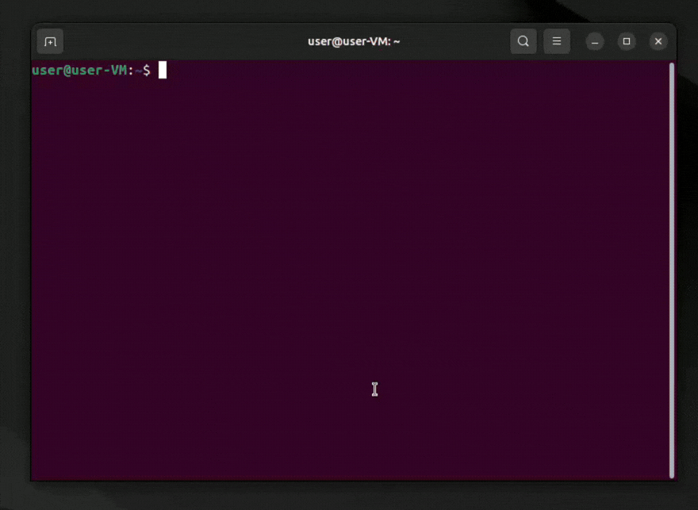

# CVE-2026-61513: VeraCrypt SetFileOwner Local Privilege Escalation

VeraCrypt's Linux elevated CoreService accepts a serialized `SetFileOwnerRequest` containing a target path and owner UID. In the audited code, it passes both values to `chown()` without Linux target validation. A process that can write to the active elevated request pipe can take ownership of privileged files and escalate to root.

| Field | Details |
|---|---|
| CVE | CVE-2026-61513; ID reserved by VulnCheck during coordinated disclosure |
| Platform | Linux |
| Documented reproduction | VeraCrypt 1.26.29 on Ubuntu 24.04 |
| Prerequisites | An active elevated CoreService session and a process running as the same UID with access to a writable service request pipe |
| Impact | Arbitrary privileged ownership changes, leading to root compromise |
| Reported | July 12, 2026 |
| Researcher | Haitam Lazaar |

## Demonstration



The PoC enumerates writable pipe descriptors in VeraCrypt processes owned by the current user. It injects ownership-change requests and verifies their effect before creating a UID-0 account and invoking `su`.

## Vulnerability

The request dispatcher performs target validation only in the macOS branch. Relevant excerpt from the [audited source](https://github.com/veracrypt/VeraCrypt/blob/48f8d87418052b5bb05f157063181c6004aa5f09/src/Core/Unix/CoreService.cpp):

```cpp
#ifdef TC_MACOSX
    ValidateMacOSXSetFileOwnerTarget(setFileOwnerRequest->Path);
#endif
    coreUnix->SetFileOwner(setFileOwnerRequest->Path, setFileOwnerRequest->Owner);
```

The Unix implementation performs the ownership change:

```cpp
void CoreUnix::SetFileOwner(const FilesystemPath &path, const UserId &owner) const
{
    throw_sys_if(chown(string(path).c_str(), owner.SystemId, (gid_t)-1) == -1);
}
```

Both arguments originate in the serialized request. On Linux, a request can therefore target a regular system file rather than a device involved in a VeraCrypt operation.

## Exploitation prerequisites

Exploitation requires an active elevated CoreService session and same-UID access to the VeraCrypt process holding the request pipe. This is not exploitable by an arbitrary local user at any time.

The demonstrated variant reuses an existing elevated session. A legitimate user first mounts a volume and completes administrator authentication. While the service remains active, another process running as that user opens a writable service-pipe descriptor through `/proc/<pid>/fd/<n>` and injects a request.

This variant does not launch a new root service or require a passwordless sudoers rule. It depends on the system allowing the same-UID process to reopen that descriptor; access is affected by process dumpability and applicable `/proc` access controls. An unrelated local user or a closed VeraCrypt session does not satisfy the prerequisites.

The included PoC changes the owner of `/etc/passwd` and `/etc/shadow`, appends the account `haxor`, and invokes `su - haxor`. It modifies system authentication files and should be reproduced in a disposable VM.

## Build and run

From this repository's root:

```sh
gcc -O2 -Wall exploit/poc_pipe_inject.c -o poc_pipe_inject
./poc_pipe_inject
```

The VeraCrypt GUI must already have an active elevated session. The demonstration account's password is `toor`. See [usage and cleanup](exploit/README.md) for the complete procedure.

## Remediation and vendor coordination

During coordinated disclosure on July 20, 2026, the VeraCrypt maintainer shared a private draft patch to address the IPC channel exposure. The patch proposed:
1. **Restricting `/proc` inspection:** Disabling frontend process dumpability via `prctl(PR_SET_DUMPABLE, 0)` so unprivileged sibling processes under the same UID cannot inspect open descriptors in `/proc/<pid>/fd/`.
2. **IPC authentication:** Requiring a random per-instance session token on incoming requests before deserialization.
3. **Path validation:** Canonicalizing target paths to block devices under `/dev/` to prevent arbitrary file target selection.

Our technical review agreed that hardening the IPC boundary effectively mitigates live-session pipe injection without requiring complex kernel volume heuristics. 

However, source inspection of public releases **1.26.30 and 1.26.31** shows that the Linux `SetFileOwner` implementation remains unvalidated, and the draft IPC authentication and dumpability protections have not yet been merged into public releases.

## Documentation

- [Technical analysis](docs/VULNERABILITY.md)
- [IPC wire format](docs/WIRE_FORMAT.md)
- [PoC usage and cleanup](exploit/README.md)

## Disclosure

The finding was reported privately on July 12, 2026. The vendor accepted the revised live-session Linux attack scenario on July 14. The stated 120-day embargo reached its deadline on November 9, 2026. These dates describe coordination; they do not establish a public CVE-record publication date.
